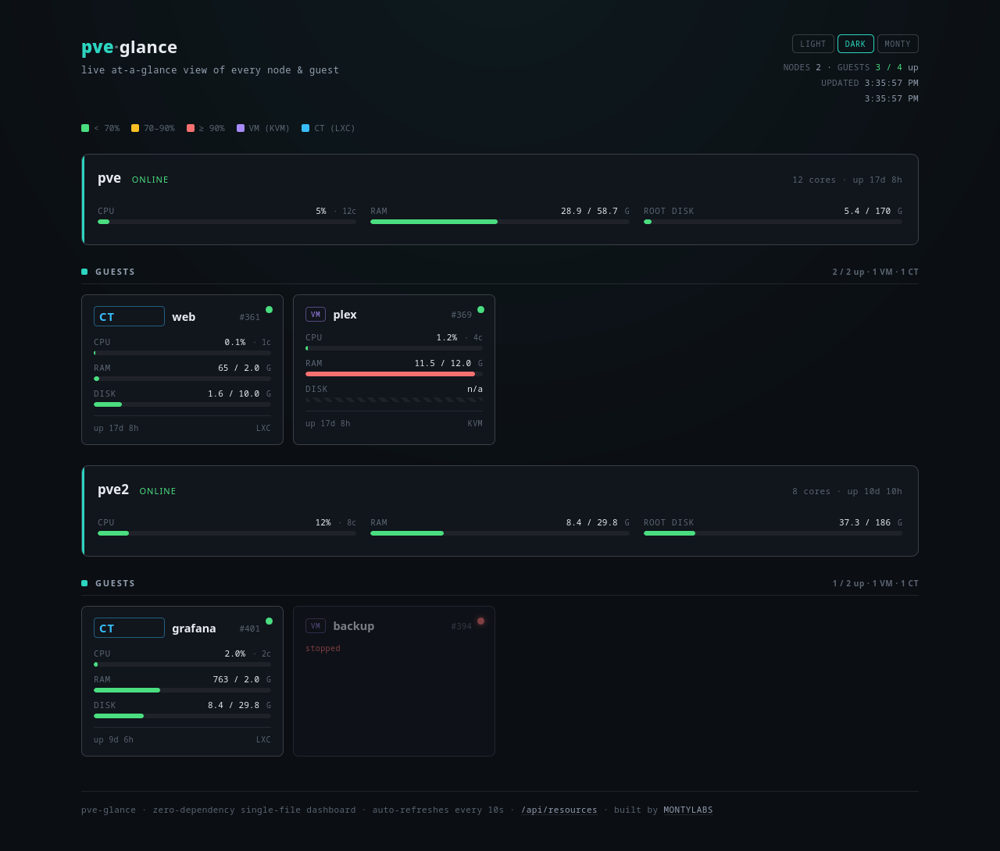
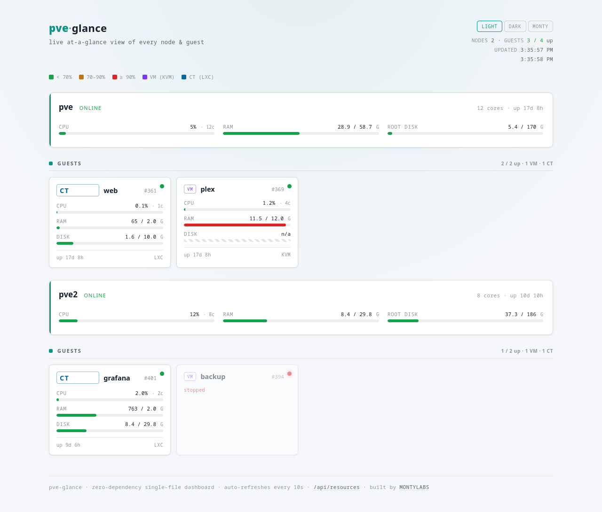
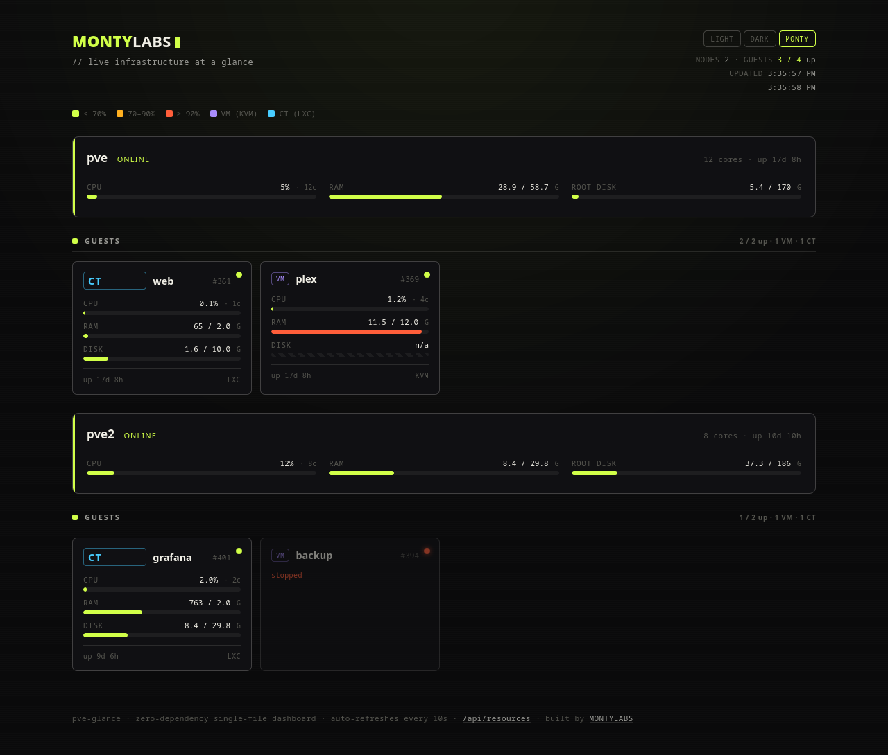

# pve-glance

A **zero-dependency, single-file** live dashboard for [Proxmox VE](https://www.proxmox.com/).
Run one Python file on a node and get an at-a-glance view of every node and guest —
live CPU, RAM, and disk meters, color-coded by load — in your browser.

- **One file, no dependencies.** Pure Python 3 standard library. Proxmox already ships it.
- **No API token, no config.** It runs on the node and uses `pvesh`, inheriting root's access.
- **Cluster-aware.** Groups guests under each node; works fine on a single host too.
- **Self-contained page.** The HTML/CSS/JS is embedded — nothing to build, no CDN calls.

```
python3 pve-glance.py        # then open http://<node-ip>:8008
```

## Screenshots

Three built-in themes — switch from the header buttons; the choice is remembered per
browser. Each guest card has CPU / RAM / disk meters colored **green < 70%**,
**amber 70–90%**, **red ≥ 90%**, with the number always shown so color is never the only
signal. VMs show disk as `n/a` (see [notes](#notes)).

**Dark** (default)



**Light**



**Monty**



## Requirements

- A Proxmox VE node (has `pvesh` and `python3`).
- Nothing else.

## Quick start (no install)

Copy `pve-glance.py` to any node and run it:

```bash
python3 pve-glance.py
```

Leave it running and open `http://<node-ip>:8008`. Ctrl-C to stop. Good for a quick look.

## Install as a service

To keep it running across reboots, use the installer (installs a systemd unit):

```bash
git clone https://github.com/antonflor/pve-glance
cd pve-glance
sudo ./install.sh
```

It copies the script to `/opt/pve-glance/`, installs `pve-glance.service`, and starts it.
Remove everything with `sudo ./uninstall.sh`.

## Configuration

All optional, via environment variables (set them in `pve-glance.service` and
`systemctl restart pve-glance`):

| Variable | Default | Meaning |
|---|---|---|
| `PVE_GLANCE_BIND` | `0.0.0.0` | Interface to bind |
| `PVE_GLANCE_PORT` | `8008` | Port to listen on |
| `PVE_GLANCE_AUTH` | *(none)* | `user:pass` to require HTTP basic auth |
| `PVE_GLANCE_CACHE` | `3` | Seconds to cache `pvesh` output across viewers |
| `PVE_GLANCE_PVESH` | `pvesh` | Path to the `pvesh` binary |
| `PVE_GLANCE_VERBOSE` | *(off)* | Log every request |

### Theming

Three built-in themes — **Dark** (default), **Light**, and **Monty** — switch from the
buttons in the header and the choice is remembered per browser (localStorage). Each is a
block of CSS variables near the top of the embedded stylesheet in `pve-glance.py`; copy a
block, give it a new `data-theme` name, and add a matching button to make your own. No
external fonts or assets are loaded in any theme.

## Security

pve-glance serves **read-only** cluster metrics and runs as **root** (so `pvesh` works
without an API token). Two things to know:

- **It has no login by default.** On a trusted home LAN that's usually fine. Anywhere
  else, set `PVE_GLANCE_AUTH=user:pass` for basic auth, and/or bind to localhost
  (`PVE_GLANCE_BIND=127.0.0.1`) and put it behind a reverse proxy with TLS.
- **Do not expose port 8008 to the internet.** It's a status panel for your LAN.

## How it works

```
browser ──/──────────▶ pve-glance.py ──pvesh get /cluster/resources──▶ Proxmox
        ──/api/resources─▶  (stdlib http.server)   (cached a few seconds)
```

The page polls `/api/resources` every 10 seconds; the server shells out to `pvesh`,
reshapes the result into `{nodes, guests}`, and caches it briefly so many open tabs
don't multiply the work.

## Notes

- **VM disk shows `n/a`.** Proxmox can't see inside a KVM guest's filesystem, so it
  reports disk usage as 0 for VMs. pve-glance shows a hatched `n/a` track rather than a
  misleading 0%. LXC container disk figures are real. (For true in-VM disk usage you'd
  need a guest agent + a metrics stack like Prometheus node_exporter.)
- **Only VMs and LXCs are shown** — storage and SDN resources are filtered out.

## Author

Built by **MONTYLABS** — [github.com/antonflor](https://github.com/antonflor). Made for my
own homelab, shared for yours. If it's handy on your cluster, a ⭐ on the
[repo](https://github.com/antonflor/pve-glance) is appreciated.

## License

MIT — see [LICENSE](LICENSE).
