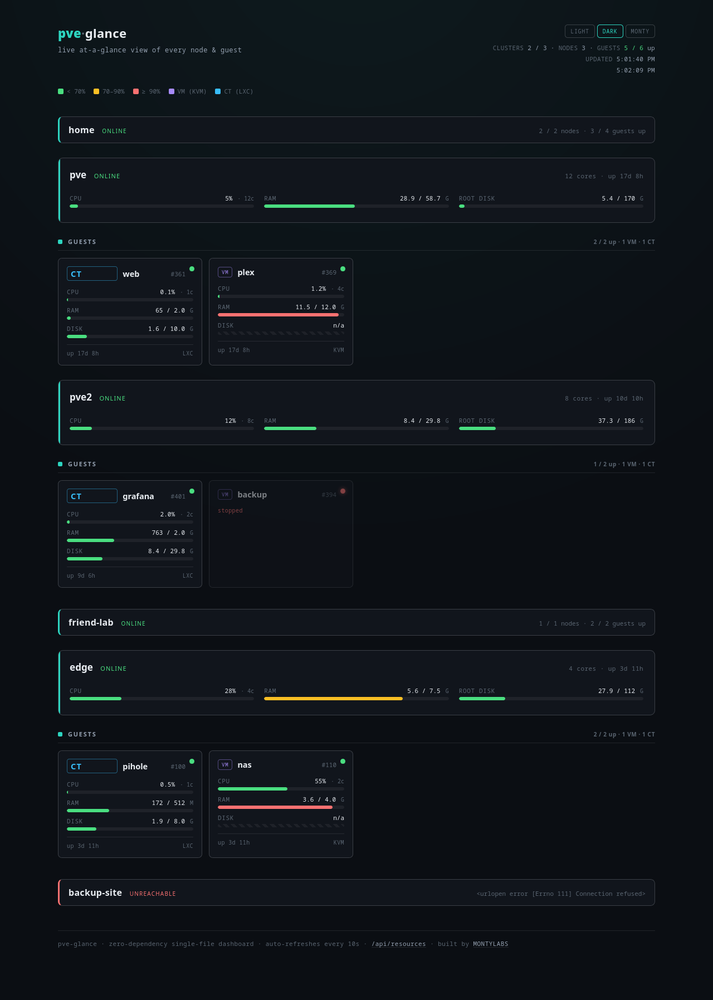
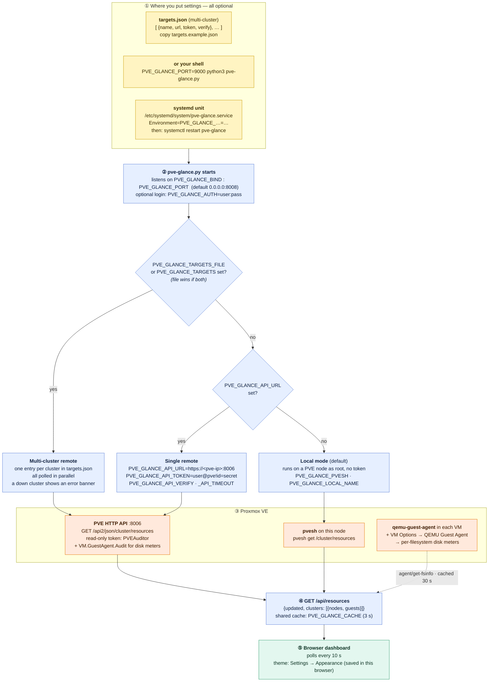
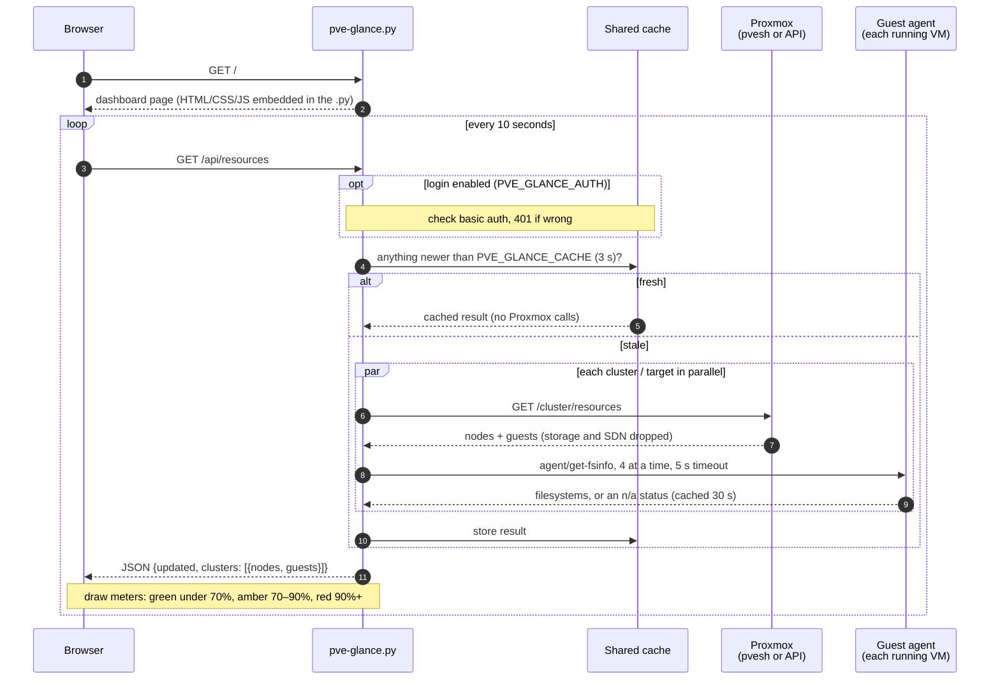

# pve-glance

A **zero-dependency, single-file** live dashboard for [Proxmox VE](https://www.proxmox.com/).
Run one Python file on a node and get an at-a-glance view of every node and guest —
live CPU, RAM, and disk meters, color-coded by load — in your browser.

- **One file, no dependencies.** Pure Python 3 standard library. Proxmox already ships it.
- **No API token, no config.** It runs on the node and uses `pvesh`, inheriting root's access.
- **One or many clusters.** Groups guests under each node; aggregate several separate PVE
  clusters into a single page (remote mode), each polled independently and in parallel.
- **Self-contained page.** The HTML/CSS/JS is embedded — nothing to build, no CDN calls.

```
python3 pve-glance.py        # then open http://<node-ip>:8008
```

## Screenshots

Five built-in themes — pick one from **Settings** at the top right; the choice is
remembered per browser. Each guest card has CPU / RAM / disk meters colored **green < 70%**,
**amber 70–90%**, **red ≥ 90%**, with the number always shown so color is never the only
signal. KVM VMs report filesystem usage through the QEMU Guest Agent (see [notes](#notes)).

**Dark** (default)


**Light**


**Monty**


## Requirements

- **Local mode (default):** a Proxmox VE node (it has `pvesh` and `python3`).
- **Remote mode:** any machine with `python3` — it reads a remote PVE over the API.
- Nothing else — no `pip install`, ever.

## Quick start (no install)

Copy `pve-glance.py` to any node and run it:

```bash
python3 pve-glance.py
```

Leave it running and open `http://<node-ip>:8008`. Ctrl-C to stop. Good for a quick look.

## Install as a service

To keep it running across reboots, use the installer (installs a systemd unit):

```bash
git clone https://github.com/antonflor/pve-glance
cd pve-glance
sudo ./install.sh
```

It copies the script to `/opt/pve-glance/`, installs `pve-glance.service`, and starts it.
Remove everything with `sudo ./uninstall.sh`.

## Configuration

All optional, via environment variables (set them in `pve-glance.service` and
`systemctl restart pve-glance`). Not sure which ones you need? The
[diagram in How it works](#how-it-works) shows where each setting goes and which
mode it switches on.

| Variable | Default | Meaning |
|---|---|---|
| `PVE_GLANCE_BIND` | `0.0.0.0` | Interface to bind |
| `PVE_GLANCE_PORT` | `8008` | Port to listen on |
| `PVE_GLANCE_AUTH` | *(none)* | `user:pass` to require HTTP basic auth |
| `PVE_GLANCE_CACHE` | `3` | Seconds to cache `pvesh` output across viewers |
| `PVE_GLANCE_PVESH` | `pvesh` | Path to the `pvesh` binary |
| `PVE_GLANCE_VERBOSE` | *(off)* | Log every request |
| `PVE_GLANCE_API_URL` | *(none)* | Read a **remote** PVE over HTTP, e.g. `https://192.168.1.30:8006`. When set, uses the API instead of local `pvesh`. |
| `PVE_GLANCE_API_TOKEN` | *(none)* | API token for remote mode: `USER@REALM!TOKENID=SECRET` |
| `PVE_GLANCE_API_VERIFY` | *(off)* | Verify the TLS cert (leave off for PVE's self-signed cert) |
| `PVE_GLANCE_API_TIMEOUT` | `15` | Per-target HTTP timeout, seconds |
| `PVE_GLANCE_TARGETS_FILE` | *(none)* | Path to a JSON file of targets — **multi-cluster** (see below) |
| `PVE_GLANCE_TARGETS` | *(none)* | The same targets JSON inline |
| `PVE_GLANCE_LOCAL_NAME` | *(hostname)* | Label for the local cluster in local mode |

### Theming

Five built-in themes — **Dark** (default), **Light**, **Monty**, **Stars** and
**Tricolor** — chosen in **Settings → Appearance** and remembered per browser
(localStorage). Each is a block of CSS variables near the top of the embedded stylesheet
in `pve-glance.py`; copy a block, give it a new `data-theme` name, add it to the
`THEMES` list and add a matching option in the Settings dialog to make your own. No
external fonts or assets are loaded in any theme.

## Remote mode (run it off the node)

By default pve-glance reads the node it runs on. To watch a PVE host from a *different*
machine — a mini-PC, a NAS, a container elsewhere — point it at the PVE API with a
read-only token. The box it runs on doesn't need to be a Proxmox node at all.

1. On the PVE host, create a read-only user and token:

   ```bash
   pveum user add monitor@pve
   pveum acl modify / --user monitor@pve --role PVEAuditor
   pveum user token add monitor@pve glance --privsep 0
   ```

   The last command prints the token secret **once** — copy it.

2. Run pve-glance anywhere:

   ```bash
   PVE_GLANCE_API_URL=https://<pve-ip>:8006 \
   PVE_GLANCE_API_TOKEN='monitor@pve!glance=<secret>' \
   python3 pve-glance.py
   ```

`PVEAuditor` is Proxmox's built-in **read-only** monitoring role.
VM filesystem collection also needs the guest-agent permission described in [notes](#notes). TLS verification is off by default (PVE ships a self-signed cert); set
`PVE_GLANCE_API_VERIFY=1` if your node has a real certificate.

### Multiple clusters

Point pve-glance at several PVE clusters at once — each with its own token — and it
aggregates them into one page, grouped by cluster. Targets are polled **in parallel**, and
an unreachable cluster shows as an error banner without breaking the others.

Create a targets file (e.g. `/etc/pve-glance/targets.json`, see [`targets.example.json`](targets.example.json)):

```json
[
  {"name":"home",       "url":"https://192.168.1.30:8006", "token":"monitor@pve!glance=...", "verify":false},
  {"name":"friend-lab", "url":"https://10.0.0.5:8006",     "token":"monitor@pve!glance=...", "verify":false}
]
```

Then run:

```bash
PVE_GLANCE_TARGETS_FILE=/etc/pve-glance/targets.json python3 pve-glance.py
```



## Security

pve-glance serves **read-only** cluster metrics and runs as **root** (so `pvesh` works
without an API token). Two things to know:

- **It has no login by default.** On a trusted home LAN that's usually fine. Anywhere
  else, set `PVE_GLANCE_AUTH=user:pass` for basic auth, and/or bind to localhost
  (`PVE_GLANCE_BIND=127.0.0.1`) and put it behind a reverse proxy with TLS.
- **Do not expose port 8008 to the internet.** It's a status panel for your LAN.
- **Remote mode:** use a `PVEAuditor` (read-only) token, and keep the token out of shell
  history — put it in the systemd unit file (readable only by root), not on the CLI.

## How it works

**Where your settings go, and which mode they turn on.** Yellow boxes are the only
things you ever edit. With nothing set, you get local mode on the node it runs on.



**What happens on every refresh:**



The page polls `/api/resources` every 10 seconds. In **local mode** the server shells out
to `pvesh`; in **remote mode** it fetches the same `/cluster/resources` endpoint over HTTP
with your token. Either way it reshapes the result into `{clusters: [{nodes, guests}]}` and
caches it briefly so many open tabs don't multiply the work. Running KVM guests
are also queried for filesystem usage via `agent/get-fsinfo` (cached 30 seconds). With multiple targets, every
cluster is fetched in parallel and collected independently, so one down cluster never
blocks or breaks the others.

## Notes

- **VM disk reporting is automatic.** Every running KVM VM is queried through
  Proxmox's `agent/get-fsinfo` endpoint. Install and run `qemu-guest-agent` inside
  each VM and enable **Options → QEMU Guest Agent** in Proxmox. A newly enabled
  agent channel may need a full VM stop/start; schedule that yourself if needed.
  Check readiness on the host with `qm agent <VMID> get-fsinfo`.
- Each local filesystem with valid usage counters gets its own disk meter,
  including Linux `/` and Windows `C:\`. Memory, optical, overlay and network
  filesystems are excluded. An empty filesystem correctly shows zero usage.
  The API includes `filesystems` and `disk_status`; VM `disk`/`maxdisk` refer to
  the root/Windows system filesystem when available, otherwise the first mount.
- Agent results (including failures) are cached for 30 seconds, with four
  concurrent queries per cluster and a five-second timeout per query. Missing
  agents, timeouts, permission failures and missing counters show an explicit
  `n/a` status while CPU, RAM and other guests continue reporting.
- **Remote agent permissions:** current Proxmox requires `VM.GuestAgent.Audit`
  on the monitored VMs in addition to the cluster monitoring permissions.
  Older PVE versions may require `VM.Monitor` (a broader privilege); inspect
  your version's API permissions before granting it. A `PVEAuditor` token alone
  may show `permission denied` for disk meters. Use a narrowly scoped custom
  role for the required agent permission; do not give the token administrator
  access. With separated token privileges, both user and token need permission.
- **Only VMs and LXCs are shown** — storage and SDN resources are filtered out.

## Author

Built by **MONTYLABS** — [github.com/antonflor](https://github.com/antonflor). Made for my
own homelab, shared for yours. If it's handy on your cluster, a ⭐ on the
[repo](https://github.com/antonflor/pve-glance) is appreciated.

## License

MIT — see [LICENSE](LICENSE).

## Appearance settings

Open **Settings** at the top right to choose Light, Dark, Monty, Stars (navy,
white and red), or Tricolor (green, white and red). Changes apply immediately
and are saved in this browser; existing theme preferences are preserved.
**Reset settings** restores Dark. If browser storage is unavailable, changes
still work for the current visit. Close the panel with Close, Escape, or by
clicking outside it.
